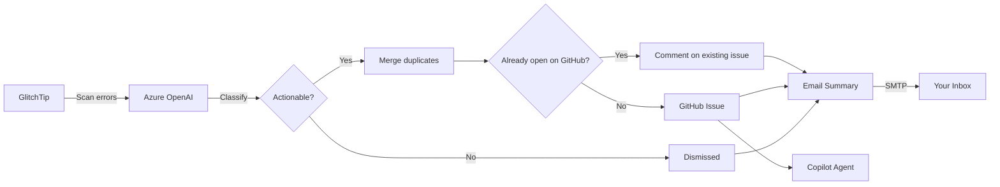

# GlitchPilot

**Your production errors, triaged and fixed before you finish your morning coffee.**

GlitchPilot connects your [GlitchTip](https://glitchtip.com) error tracker to AI-powered triage. Every night it scans your projects, decides which errors actually matter, files GitHub issues with detailed fix recommendations, and assigns GitHub Copilot to start working on them — all before your team wakes up. You get a clean summary email with everything that happened.

### What it does

1. **Scans** error groups from GlitchTip (configurable lookback window)
2. **Classifies** each error with Azure OpenAI — actionable or noise, severity, error type
3. **Merges duplicates** — errors GlitchTip split into several groups are merged into one issue; optionally, errors that match an already open issue / PR are not filed again
4. **Files GitHub issues** with structured problem descriptions, acceptance criteria, and fix recommendations
5. **Assigns Copilot** coding agent to immediately start working on fixes
6. **Sends email** — per-project summary of all classified errors with links to GitHub issues — once Copilot has finished, including token and AI-credit usage (see [Usage Tracking](#usage-tracking))

### How to run it

- **CLI** (`GlitchPilot.Console`) — run on-demand from your terminal
- **Azure Function** (`GlitchPilot.Functions`) — set it and forget it with a nightly timer trigger

---

## Pipeline Flow



For each monitored project, GlitchPilot collects recent errors from GlitchTip, filters by environment and occurrence count, then sends each to Azure OpenAI for classification. Actionable errors get a GitHub issue (with Copilot assigned to start fixing). Everything — actionable and dismissed — lands in a per-project email summary.

---

## CLI Modes

```bash
# Main mode — scan, classify, file issues, send email
dotnet run --project src/GlitchPilot.Console -- --mode triage

# Send the delayed triage emails of pending runs (with Copilot usage); --force = don't wait for Copilot
dotnet run --project src/GlitchPilot.Console -- --mode report
dotnet run --project src/GlitchPilot.Console -- --mode report --force

# Debug — inspect a single GlitchTip issue
dotnet run --project src/GlitchPilot.Console -- --mode probe --issue 4
dotnet run --project src/GlitchPilot.Console -- --mode probe --issue 4 --file        # also file GitHub issue
dotnet run --project src/GlitchPilot.Console -- --mode probe --issue 4 --file --email # also send email

# Debug — test GlitchTip connectivity
dotnet run --project src/GlitchPilot.Console -- --mode verify
```

---

## Azure Function

`NightlyTriageFunction` is a timer-triggered function that calls `TriagePipeline.RunAsync()` — the same code as `--mode triage`.

- Schedule is configurable via the `TRIAGE_SCHEDULE` app setting (cron format, default: `0 0 5 * * *`)
- Set `WEBSITE_TIME_ZONE` in Azure Portal for local timezone support
- All other config comes from Azure Function App Settings (same env vars as `.env`)
- Runs on Consumption plan (executes in under a few minutes)
- `FileIssue` (HTTP, `GET/POST /api/file-issue`) serves the "Create GitHub issue anyway" button from the email (see [Filing Dismissed Errors Manually](#filing-dismissed-errors-manually))
- `TriageReport` runs every 15 minutes and sends the triage emails of pending runs once the Copilot sessions finished (see [Usage Tracking](#usage-tracking)). It uses the function's own storage account (`AzureWebJobsStorage`) unless `USAGE_STORAGE_CONNECTION` is set.

---

## Duplicate Handling

GlitchTip sometimes splits one bug into several error groups (variable data in messages, different call sites, wrapped exceptions). Without deduplication every group would trigger its own Copilot run. GlitchPilot deduplicates in three stages per project:

1. **Merge within a run** (`MERGE_DUPLICATES_ENABLED`, default `true`): After classification, all actionable errors of a project are sent to Azure OpenAI in one request, which groups errors that share a root cause. Each group gets **one** GitHub issue (the error with the highest priority, then most occurrences, is the primary). The issue carries `glitchtip:{id}` labels for **all** merged errors and lists them under "Merged GlitchTip Errors". The email shows the merged errors below the primary.
2. **Label check**: GlitchPilot searches the repository (GitHub search API, open issues and PRs) for the `glitchtip:{id}` labels of all actionable errors of the run — independent of any other labels. If any error of a group already has an open issue or PR with its label, no new issue is filed; the labels of newly merged errors are added and the error is listed under "Already Known". If GitHub cannot be queried, no issues are filed for that project in this run (to avoid duplicate Copilot runs); the email says so.
3. **History scan** (`DUPLICATE_SCAN_ENABLED`, default `false`): Remaining groups are compared with open GlitchPilot issues (up to `DUPLICATE_SCAN_MAX_ISSUES`) and open pull requests of the repository — e.g. a fix from three months ago that was never merged. Only high-confidence matches count. For a match GlitchPilot files **no** issue and starts **no** Copilot run; instead it adds the `glitchtip:{id}` labels, the first `GITHUB_LABELS` label and a recurrence comment to the existing issue / PR (so the next run finds it via the label check and no further comment is posted) and lists the error under "Already Known" in the email (with link, age, linked PRs and the AI's reasoning).

Boolean settings accept `true/false`, `1/0`, `yes/no`, `on/off`; any other value stops the run with an error. All AI deduplication steps fail open: if Azure OpenAI is unavailable or answers with invalid JSON, GlitchPilot behaves as without deduplication.

---

## Filing Dismissed Errors Manually

Transient errors with few occurrences are dismissed and get no issue. If you know they should be fixed anyway, the email shows a **Create GitHub issue anyway** button on every dismissed error of type `transient`. No GitHub login is needed:

1. The button opens a confirmation page served by the `FileIssue` function. Opening it changes nothing (mail scanners prefetch links), but it shows whether the error is already tracked.
2. Optionally describe how it should be fixed — the notes go into the issue under "Notes from the Team", above the AI recommendation, so Copilot follows them.
3. **Create GitHub issue** loads the error from GlitchTip again, re-classifies it for fresh issue text and files it like any other issue (labels, `glitchtip:{id}`, Copilot assignment) in the repository configured in `PROJECTS`. If an open issue / PR already carries its label, or GitHub cannot be queried, nothing is filed.

The link is signed with HMAC-SHA256 (`LINK_SIGNING_KEY`) and expires after `LINK_EXPIRY_DAYS`. The signature is the only authorization: anyone holding an unexpired link from the email can file that one error, so treat the email accordingly. The button only appears when `FILE_ISSUE_URL` is set — in the Console as well, but the link always points at the deployed function. Generate a key e.g. with `openssl rand -base64 48`; rotating it invalidates all links sent so far.

---

## Usage Tracking

GlitchPilot records what the Copilot cloud agent costs for the issues it files (GitHub AI credits) and stores it as JSON for later evaluation. The Azure OpenAI calls of the triage itself are not tracked.

| Source | What | How exact |
|--------|------|-----------|
| **Copilot sessions** | Per filed issue: Copilot's PR, the agent's workflow runs (sessions), status and minutes | Exact (GitHub API) |
| **GitHub billing** | AI credits / USD per model and SKU for the UTC day of the run — at the start of the run, at report time, and the difference (*during this run*) — plus the previous day (final) | Exact, but **per day only** |
| **Cost per issue** | The cloud-agent cost *during this run* split across the run's issues by session minutes | Estimate (upper bound if other agent sessions ran at the same time) |

GitHub does not report Copilot cost per session or per issue — only per day, model and SKU (`/users/{user}/settings/billing/ai_credit/usage`, falling back to `premium_request/usage` for legacy plans). So the triage run reads the day's totals **before** it files any issue, and the report reads them again once the Copilot sessions finished: the difference is what was used during the run, so usage from earlier that day no longer counts. With a single filed issue and no other agent sessions at the same time, that is the issue's cost. If the start snapshot is not usable (run crossed midnight UTC, or a billing call failed), the estimate falls back to the whole day (`costBasis`: `run` or `day`). Billing data can lag: usage that is booked late can still shift between the two snapshots, so each report also includes the previous day's final numbers.

**Delayed email.** With usage storage configured, the triage run stores its emails as a *pending run* instead of sending them. `TriageReport` (Azure Function, every 15 min) or `--mode report` (CLI) checks the Copilot sessions and sends the emails — with a "Usage & cost" section — as soon as every filed issue has a finished Copilot session, at the latest after `REPORT_MAX_DELAY_MINUTES` (default 120). Runs without new issues are sent right away. Without storage, the email is sent immediately and has no usage section.

**JSON.** Blob container `USAGE_CONTAINER` (default `glitchpilot-usage`):

- `pending/{runId}.json` — waiting for Copilot (includes the rendered emails)
- `runs/yyyy/MM/dd/{runId}.json` — final record: `projects[].issues[].copilot` (`pullRequests`, `sessions`, `totalSessionMinutes`, `estimatedGrossUsd`, `estimatedAiCredits`), `billingAtStart`, `billing`, `billingDuringRun`, `costBasis`, `billingPreviousDay`

The billing endpoints cover **personal** Copilot plans. The classic `GITHUB_TOKEN` may need the `user` scope for them; if the call fails, the email shows the API error and everything else is still reported. Every step of the cost tracking fails soft: whatever cannot be determined (sessions, billing, the estimate, the usage storage) shows as `n/a` with the reason, and the triage email is still sent.

---

## GitHub Issue Filing

- **Duplicate detection**: Label `glitchtip:{errorId}` — checked before creating (see [Duplicate Handling](#duplicate-handling))
- **Issue body**: Problem description, acceptance criteria, files to investigate, stack trace, breadcrumbs, error details, tags, recommendation
- **Labels**: `glitchpilot`, `glitchtip:{errorId}`, `priority:{level}`, `type:{type}`, optional agent label
- **Copilot assignment**: Assigns `copilot-swe-agent[bot]` via GitHub API after issue creation

---

## Email Templates

- **Triage summary** (per project): Actionable issues with priority badges, OpenAI summaries, and GitHub issue links. Merged duplicates are listed below their primary issue. Errors matched to open GitHub work appear under "Already Known". Dismissed issues shown separately — transient ones with a "Create GitHub issue anyway" button when `FILE_ISSUE_URL` is set. Footer with filter settings.
- **All clear** (per project): Green checkmark, no issues need attention.
- Timestamps use local time (`DateTimeOffset.Now`)

---

## Environment Variables

| Variable | Required | Default | Description |
|----------|----------|---------|-------------|
| `GLITCHTIP_URL` | yes | | GlitchTip base URL |
| `GLITCHTIP_TOKEN` | yes | | GlitchTip API token |
| `GLITCHTIP_ORG` | yes | | GlitchTip organization slug |
| `OPENAI_ENDPOINT` | yes | | Azure OpenAI endpoint (base URL only) |
| `OPENAI_KEY` | yes | | Azure OpenAI API key |
| `OPENAI_MODEL` | no | `gpt-4o` | Deployment name |
| `GITHUB_TOKEN` | yes | | Classic PAT with `repo` scope |
| `GITHUB_LABELS` | no | `glitchpilot` | Comma-separated base labels |
| `GITHUB_AGENT_LABEL` | no | | Label for Copilot-assigned issues |
| `GITHUB_ASSIGN_TO` | no | | Username to assign issues to |
| `GITHUB_COPILOT_MODEL` | no | | Copilot model (leave empty for auto) |
| `GITHUB_BILLING_USER` | no | owner of `GITHUB_TOKEN` | GitHub user whose personal Copilot plan is billed |
| `SMTP_HOST` | yes | | SMTP server hostname |
| `SMTP_PORT` | no | `587` | SMTP port |
| `SMTP_USER` | yes | | SMTP username |
| `SMTP_PASS` | yes | | SMTP password |
| `MAIL_FROM` | yes | | Sender email address |
| `MAIL_RECIPIENTS` | yes | | Comma-separated recipient emails |
| `PROJECTS` | yes | | JSON array of monitored projects (see below) |
| `MIN_OCCURRENCES` | no | `1` | Minimum error count to consider |
| `LOOKBACK_HOURS` | no | `24` | Hours to look back for errors |
| `EXCLUDE_TITLES` | no | | Comma-separated title patterns to skip |
| `EXCLUDE_IDS` | no | | Comma-separated GlitchTip IDs to skip |
| `MERGE_DUPLICATES_ENABLED` | no | `true` | Merge errors of one run with the same root cause into one issue |
| `DUPLICATE_SCAN_ENABLED` | no | `false` | Compare new errors with open GitHub issues / PRs before filing |
| `DUPLICATE_SCAN_MAX_ISSUES` | no | `50` | Max. open issues per repository considered by the history scan |
| `FILE_ISSUE_URL` | no | | Full URL of the `FileIssue` function, e.g. `https://<app>.azurewebsites.net/api/file-issue`. Enables the button for dismissed transient errors |
| `LINK_SIGNING_KEY` | if `FILE_ISSUE_URL` | | Secret (≥ 32 chars) that signs the button links; same value for triage and function |
| `LINK_EXPIRY_DAYS` | no | `14` | Days a button link stays valid |
| `USAGE_STORAGE_CONNECTION` | no | `AzureWebJobsStorage` | Blob Storage connection string for run records / usage JSON |
| `USAGE_CONTAINER` | no | `glitchpilot-usage` | Blob container name |
| `REPORT_MAX_DELAY_MINUTES` | no | `120` | Send the triage email at the latest this long after filing, even if Copilot is not done |
| `TRIAGE_SCHEDULE` | no | `0 0 5 * * *` | Cron schedule (Azure Function only) |

### PROJECTS format

Each entry maps a GlitchTip project to a GitHub repository:

```json
[
  {
    "slug": "my-app",
    "targetEnvironment": "Production",
    "gitHubOwner": "my-org",
    "gitHubRepo": "my-app-repo"
  },
  {
    "slug": "other-service",
    "targetEnvironment": "Production",
    "gitHubOwner": "my-org",
    "gitHubRepo": "other-service-repo"
  }
]
```

---

## Tests

```bash
dotnet test GlitchPilot.slnx
```

---

## DI Registration

All services are registered via `services.AddGlitchPilot()` in `Registration.cs`:

```csharp
services.AddHttpClient<IGlitchTipClient, GlitchTipClient>();
services.AddSingleton<IErrorClassifier, ErrorClassifier>();
services.AddSingleton<IIssueFiler, IssueFiler>();
services.AddSingleton<IChatCompleter, AzureChatCompleter>();
services.AddSingleton<IDuplicateDetector, DuplicateDetector>();
services.AddSingleton<ISmtpMailer, SmtpMailer>();
services.AddTransient<ManualFilingService>();
services.AddSingleton<IRunStore, BlobRunStore>();
services.AddSingleton<ICopilotUsageClient, CopilotUsageClient>();
services.AddTransient<ReportPipeline>();
services.AddTransient<TriagePipeline>();
services.AddTransient<VerifyPipeline>();
services.AddTransient<ProbePipeline>();
```

Both `Program.cs` files (Console and Functions) call the same `AddGlitchPilot()`.

---

## Key Dependencies

| Package | Purpose |
|---------|---------|
| `Azure.AI.OpenAI` | Azure OpenAI chat completions |
| `MailKit` | SMTP email delivery (STARTTLS) |
| `Octokit` | GitHub issue creation and label queries |
| `Azure.Storage.Blobs` | Pending runs and usage JSON |
| `Microsoft.Azure.Functions.Worker` | Azure Functions isolated worker (Functions project only) |
| `Microsoft.Azure.Functions.Worker.Extensions.Http` | HTTP trigger for the "Create GitHub issue" button (Functions project only) |

---

## Known Limitations

- **Copilot model override**: Setting `GITHUB_COPILOT_MODEL` to a specific model (e.g. `claude-opus-4.6`) may cause "repository ruleset violation" errors depending on your GitHub plan. Leave empty for auto-selection.
- **Azure OpenAI gpt-5-mini**: Does not support `max_tokens` (use `max_completion_tokens`), does not support `temperature=0`, does not support `ResponseFormat`. The current code works around all of these.
